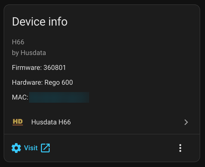
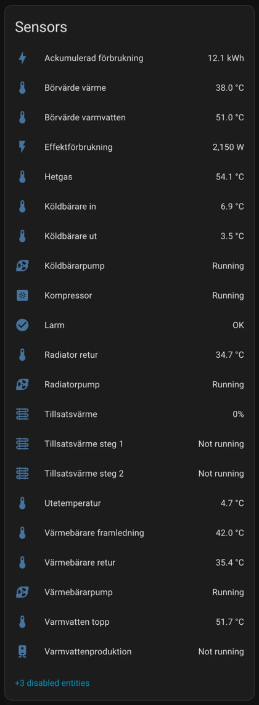
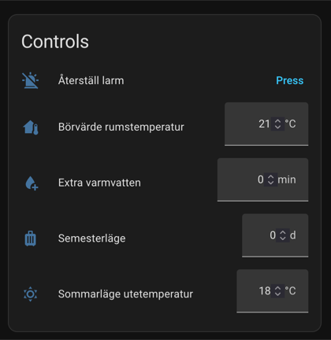
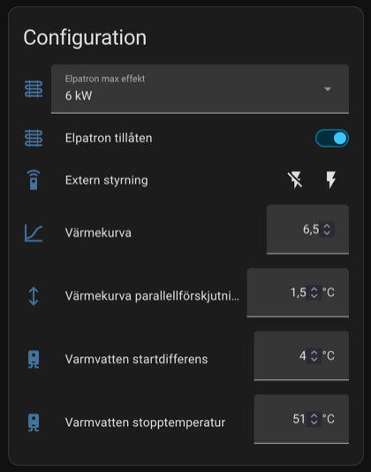
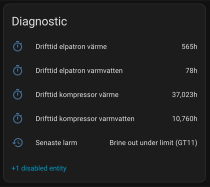

# Husdata H66 Modbus Integration for Home Assistant

A Home Assistant custom integration for the [Husdata H66](https://husdata.se/produkt/h66-wifi-eth-gateway-styr-din-varmepump/) heat pump gateway. It communicates with the H66 over **Modbus TCP** and exposes heat pump values and writable settings as native Home Assistant entities.

This repository is a fork of the [original Husdata H66 Modbus integration](https://github.com/jonnybergdahl/HomeAssistant_Husdata_H66_Modbus_Integration), with additional support for **Rego 1000 / Pro Control 500** controllers.

## Features

- Temperature, operating-hour, power and energy sensors
- Binary sensors for compressor, pumps, heater stages, hot-water production and alarm
- Writable settings exposed as numbers, switches and selects, with units and limits
- Rego 1000 room setpoints, heating curves, room sensor influence, outdoor temperature offset, extra hot water, holiday mode, summer mode and hot-water programs
- Alarm reset button
- Reads the register map, firmware, controller and MAC address from the H66 web page
- Uses Home Assistant's Modbus connection handling and the `husdata-h66-modbus` library

Tested with an IVT Greenline using a Rego 600 controller and with a Rego 1000 / Pro Control 500 controller (firmware 3.6.0). Available entities depend on the heat pump, controller and registers reported by the H66.

## Screenshots

The device page for an IVT Greenline with a Rego 600, with Home Assistant in Swedish:

<table>
  <tr>
    <td valign="top">
      
      <br>
    </td>
    <td valign="top">
      <br>
      <br>
      
    </td>
  </tr>
</table>

## Before you start

Modbus TCP is disabled in the H66 by default:

1. Open the H66 web page, then **Config** > **Modbus**
2. Set `MODBUS_PORT` to `502`
3. Restart the H66

The H66 accepts only one Modbus client at a time. Home Assistant keeps its connection open, so other Modbus tools cannot connect while the integration is running. The H66's MQTT output is separate and can continue to work alongside Modbus.

## Installation

### HACS

Add this repository as a custom integration repository:

[](https://my.home-assistant.io/redirect/hacs_repository/?owner=alsFC&category=Integration&repository=Home-Assistant-Husdata-H66-Modbus-Integration)

Or add it manually:

1. Go to **HACS** (or **Marketplace**, depending on your Home Assistant version)
2. Open the menu (⋮) and select **Custom repositories**
3. Add `https://github.com/alsFC/Home-Assistant-Husdata-H66-Modbus-Integration` and choose **Integration**
4. Search for **Husdata H66**
5. Install the integration

If your Home Assistant version uses the older HACS interface, restart Home Assistant after downloading the integration.

### Manual installation

1. Copy the `custom_components/husdata_h66` folder into your Home Assistant `config/custom_components/` directory
2. Restart Home Assistant

## Setup

Go to **Settings** > **Devices & services** > **Add integration**, search for **Husdata H66**, and enter:

- The H66 host name or IP address
- Port `502` (unless changed in the H66)
- Unit ID `1` (unless changed)

You can also use the Home Assistant setup link:

[](https://my.home-assistant.io/redirect/config_flow_start/?domain=husdata_h66)

The polling interval defaults to 30 seconds. Change it using the integration's **Configure** action. If the H66's address changes, use **Reconfigure**.

## How it works

The H66 numbers its Modbus registers one per parameter, in the order shown on its home page. Register addresses can vary by heat pump and may change after an H66 firmware update or when custom registers are added.

When the integration is added and each time it starts, it reads the register map, firmware version, controller and MAC address from the H66 home page. If the page cannot be read, it reuses the last stored register map.

For Rego 1000, the integration applies controller-specific variable definitions (entity type, scale, units and writable ranges) while using the live register addresses provided by the H66.

Custom registers added in the H66 are also exposed as sensors, named according to the H66 web page.

## Entities

Only entities for registers reported by your H66 are created. Names and available entities vary by controller and heat pump. Entity IDs are based on the device name and register key; the exact prefix depends on the name assigned to the device in Home Assistant.

### Common sensors and statuses

| Entity | Type | Notes |
|---|---|---|
| Radiator forward/return, Heat carrier forward/return, Brine in/out, Outdoor/Indoor temperature, Hot water top/middle, Hot gas | Sensor | Temperatures in °C; availability depends on the heat pump |
| Heating setpoint, Hot water setpoint | Sensor | Setpoints reported or calculated by the heat pump |
| Additional heat | Sensor | Additional/electric heat status, typically % |
| Power consumption, Accumulated consumption | Sensor | H66-calculated values based on power settings configured on the H66 |
| Compressor/heater operating hours | Sensor | Diagnostic counters |
| Last alarm | Sensor | Last alarm event, even if no alarm is currently active; raw code is an attribute |
| Compressor, additional heat stages, pumps, hot-water production | Binary sensor | Operating status |
| Alarm | Binary sensor | Indicates an active alarm |

### Rego 1000 / Pro Control 500 settings

When the H66 reports the corresponding Rego 1000 registers, the integration can expose:

| Setting | Entity type | Notes |
|---|---|---|
| Room temperature setpoint and setpoint 2 | Number | Writable room setpoints |
| Room sensor influence | Number | Range 0–10, step 0.1 |
| Heating curve 1 and 2 left/right points | Number | Writable curve points |
| Outdoor temperature offset | Number | Writable offset |
| Extra hot water duration | Number | Hours |
| Holiday mode | Switch | On/off |
| Summer mode | Select | Winter, automatic or summer |
| Hot water program | Select | Comfort or economy |
| Hot water time program | Select | Always, program 1 or program 2 |
| Pool temperature setpoint | Number | Created if the H66 reports a writable pool setpoint |

### Other settings

Depending on the controller and writable registers, the integration may expose room temperature setpoint, extra hot water, summer mode outdoor temperature, holiday mode, heat curve and parallel offset, hot-water stop temperature and start difference, electric heater maximum power (select), electric heater allowed (switch), and external control.

The H66 may not support reading back every setting. Write-only controls show the last value set by Home Assistant and are marked as assumed state. Husdata warns that external control may behave unpredictably on a Rego 600.

### Alarm reset

The **Reset alarm** button resets the heat pump alarm. The heat pump is switched off for approximately 10 seconds and then switched on again.

## MQTT and Modbus

The H66's MQTT output can remain enabled while this integration is used. Both paths can be run in parallel for comparison. Keep in mind that the H66 supports only one Modbus client at a time.

Some MQTT values, including consumption counters or calculated statistics provided by other software, may not have a direct Modbus equivalent. Keep those entities separately if they are used by utility meters or the Home Assistant Energy dashboard. When changing a utility meter's source, retain the existing utility meter entity if you want to preserve its entity identity and accumulated statistics.

## Development

```bash
uv venv --python 3.14 && uv pip install -r requirements_test.txt
.venv/bin/pytest
.venv/bin/ruff check . && .venv/bin/ruff format --check .
```

## License

MIT
